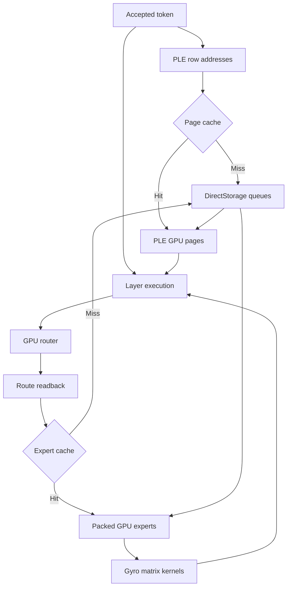
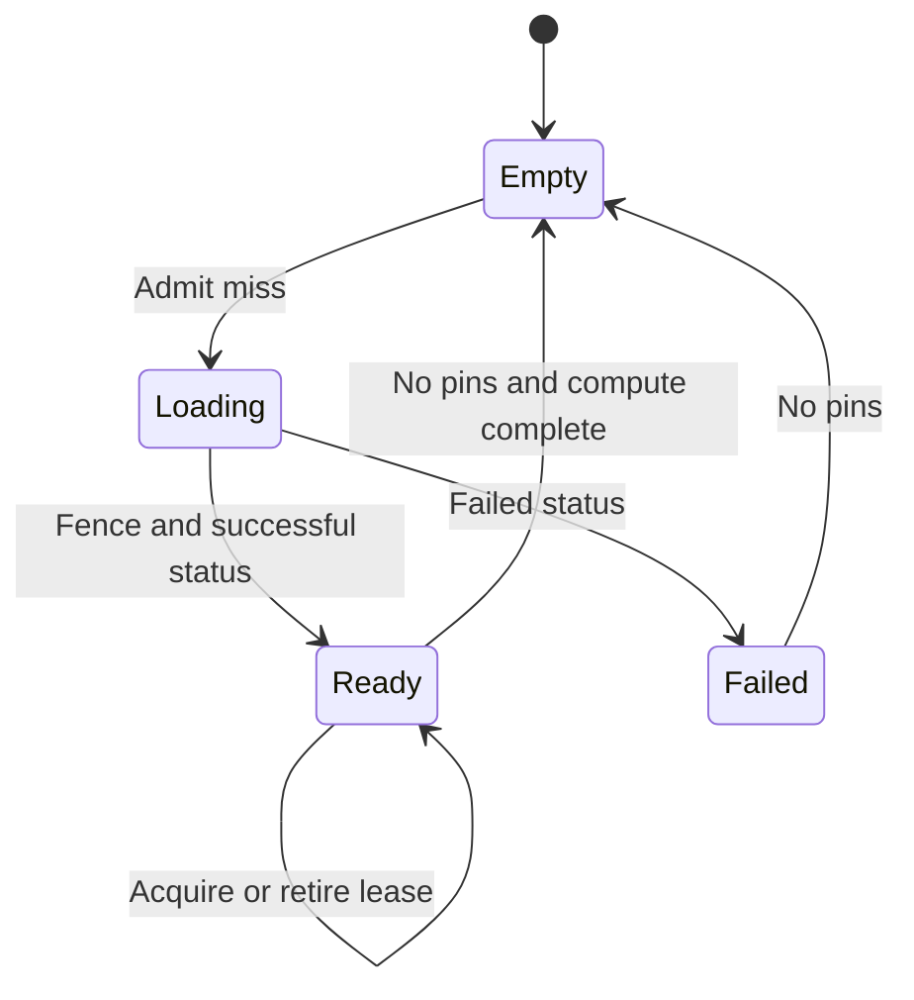

# Engine architecture

## Design decision

The runtime keeps packed experts in GPU memory when the memory budget permits that choice.
DirectStorage fills missing expert slots and supplies pages from the learned n-gram table.
The model already fits some target cards with packed weights.
Unnecessary expert eviction adds disk traffic to each token.

Zig owns the model adapter, memory policy, scheduler, and application interface.
A small C++ bridge owns Microsoft COM interfaces and SDK structures.
HLSL owns GPU kernels.
The C ABI keeps SDK changes outside the Zig core.

This document describes the intended engine.
The current package implements the components marked in the README.
It does not implement the complete schedule below.

## Data paths



PLE addresses depend on token IDs.
Expert routes depend on hidden activations.
This difference determines which reads can start early with exact addresses.
The runtime cannot know an arbitrary future layer's exact expert set before its router executes.

The CPU submits DirectStorage requests.
The public API does not provide an HLSL instruction that turns arbitrary router output into file reads.
A demand path therefore includes route readback or another host-visible route source.
Speculative expert prefetch can hide some delay, but wrong predictions consume bandwidth and cache capacity.

## Memory design

| Allocation | Lifetime | Policy |
| --- | --- | --- |
| Nonexpert weights | Model session | Resident |
| Packed routed experts | Model session or cache lease | Resident when possible, otherwise cached |
| Decoded tiles | A matrix operation | Bounded scratch |
| Activation transforms | A projection input | Reuse between gate and up |
| PLE pages | Page cache lease | Separate cache from expert payloads |
| KV and recurrence state | Request | Explicit context budget |
| Route readback | A layer submission | Ring with fence ownership |
| Upload and readback buffers | Queue work | Pool with fence ownership |

The 50.6642 GiB n-gram table is a learned model tensor.
It stays separate from the expert cache.
Each token requests only 2,720 useful bytes before page expansion.
Four-kibibyte pages avoid tiny unaligned storage requests and permit reuse.
Page expansion changes the physical traffic and random-read count.
Target-device measurements determine whether DirectStorage or ordinary cached reads perform better for that path.

A complete Coder expert contains 4,915,200 weights.
Its packed representation occupies 1,305,600 bytes.
Its FP16 representation occupies 9,830,400 bytes.
Ten fully expanded experts require 93.75 MiB for one layer.
All retained experts require 112.5 GiB at FP16 before other weights and state.

The engine therefore preserves packed persistent storage.
Decoded tiles occupy a bounded temporary area.
Expansion for an entire layer can also serve as an early correctness baseline with an explicit memory budget.

## Kernel strategy

### Single-token decode

Single-token expert execution has low matrix reuse.
A fused Gyro decode and matrix-vector kernel avoids a full decoded matrix write.
Each workgroup decodes the needed trellis blocks and accumulates output values.
The normative 8 KiB codebook can occupy shared memory or a cache-friendly resource.

Thread-scope LinAlg vector operations provide another candidate implementation.
Their benefit depends on the hardware, batch shape, and operand layout.
The engine needs measurements against the fused baseline.
The first kernel does not need to force every operation through matrix hardware.

### Prefill and concurrent decode

The scheduler groups token rows by selected expert.
A group of tokens can reuse a decoded expert tile.
Wave-scope or threadgroup-scope LinAlg matrix operations can amortize decode and operand loads.
The dispatch shape comes from the supported configurations on the actual adapter.

The first LinAlg implementation can use FP16 operands and FP32 accumulation.
The released Gyro bytes are neither FP16 matrices nor ordinary INT2 operands.
The custom codebook, scales, and rotation require their own operations.
LinAlg layout conversion does not decode that format.

The GPU reference decoder in this package emits FP32 values for conformance.
A production tile decoder requires a selected numeric format and its own error budget.
It also requires GPU Hadamard transforms or an equivalent inverse transform for weights.

### Transform placement

For each listed weight, the stored matrix is `W D H`.
The runtime supplies `H D x` as the input.
The normalized Hadamard matrix satisfies `H H = I`.
The diagonal sign matrix satisfies `D D = I`.
The resulting matrix product equals `W x`.

The gate and up matrices share the transformed hidden input.
The down matrix receives a separately transformed expert intermediate.
The nonlinear activation prevents movement of the down transform before the gate and up computation.

## Slot state and queue ownership

The cache policy uses one key for each layer, expert, and representation variant.
A lease identifies a slot and its generation.
Pins protect work that owns a slot before compute submission.
Storage and compute fences belong to separate typed timelines.



A storage fence proves completion, but a status result proves success.
A failed read cannot create a usable expert entry.
A completed storage fence cannot release a slot that compute still uses.
A stale lease cannot retire a different expert after slot reuse.

Batch admission reserves all selected experts or changes nothing.
This avoids partial eviction when a layer cannot obtain enough slots.
The production scheduler can also choose explicit expert microbatches when the memory budget cannot hold every selected expert.
The current planner requires enough capacity for a complete layer route.

### Demand-read procedure

1. Read the completed router output.
2. Validate each local expert ID against the model metadata.
3. Reserve the selected cache leases as one transaction.
4. Submit the missing projection ranges through DirectStorage.
5. Verify the storage status after its fence completes.
6. Submit the expert computation with valid leases.
7. Retire each lease with the final compute fence for its use.
8. Reuse a slot only after its pins and compute dependency clear.

## DirectStorage constraints

The source GGUF stores gate, up, and down projections in separate tensors.
Each expert therefore needs three source ranges.
The reader calculates those ranges from block sizes and tensor dimensions.
No model repack is necessary for the first transport path.

The bridge uses `DSTORAGE_COMPRESSION_FORMAT_NONE`.
Gyro is a custom numeric representation, separate from DirectStorage's GDeflate format.
The runtime transfers packed bytes, then performs Gyro decode in a compute shader.

The DirectStorage documentation describes staging buffers for the raw transfer path.
The API does not establish a universal NVMe-to-VRAM path without host memory.
The engine measures actual transfer bandwidth and host overhead on the chosen system.

The present bridge uses an independent resource for each slot.
Each resource returns to `COMMON` between operations.
That choice avoids simultaneous writes and shader reads in different portions of one resource with incompatible states.
A later arena design needs an explicit resource and synchronization model.

## Bandwidth model

For routed layer count `L`, active experts `k`, expert bundle bytes `S`, and byte hit ratio `h`:

```text
expert_bytes_per_token = L * k * S * (1 - h)
storage_ceiling_tokens_per_second = sustained_useful_bytes_per_second / expert_bytes_per_token
```

Coder has `L=48`, `k=10`, and `S=1,305,600`.
A zero-hit token therefore needs 626,688,000 useful expert bytes.
The following table assumes a sustained useful transfer rate of 7,000,000,000 bytes per second.

| Byte hit ratio | Expert bytes per token | I/O-only ceiling |
| --- | ---: | ---: |
| 0% | 626,688,000 | 11.17 tokens/s |
| 50% | 313,344,000 | 22.34 tokens/s |
| 90% | 62,668,800 | 111.70 tokens/s |

These are calculated ceilings, not benchmark results.
They exclude compute, route readback, page expansion, PLE traffic, and queue overhead.
The serialized layer path also adds latency that a bandwidth-only model cannot represent.
Prefill changes the unique expert set and amortization across token rows.

## Completion gates

| Gate | Required evidence |
| --- | --- |
| Format correctness | Exact CPU parity for quantized blocks, metadata, and transforms |
| GPU primitive correctness | Transfer equality and GPU decoder parity on the target driver |
| Layer correctness | Intermediate tensors agree with the pinned reference runtime within explicit tolerances |
| Stateful correctness | Prefill, decode, reset, context extension, and batch permutations preserve model behavior |
| Whole-model correctness | Fixed prompts and token traces agree under controlled sampling |
| Performance | Warm and cold latency, miss bytes, queue delay, memory peak, and token rate on named hardware |

The first runtime milestone is deterministic full-graph inference with resident packed experts.
That milestone includes the learned PLE path and all request state.
The next milestone adds expert eviction with recorded routes and measured miss costs.
Multi-token prediction and speculative expert prefetch follow those gates.

The base graph requires gated delta recurrence, sparse attention, and hyper-connections.
Those operations remain essential even when the matrix and storage paths are complete.
The pinned graph in MODEL.md provides the implementation authority.

## Primary sources

- [Verified model and runtime sources](MODEL.md)
- [Microsoft LinAlg proposal](https://github.com/microsoft/hlsl-specs/blob/main/proposals/0035-linalg-matrix.md)
- [Microsoft runtime capability specification](https://microsoft.github.io/DirectX-Specs/d3d/D3D12LinearAlgebraRuntimeFeatureSupport.html)
- [DirectStorage developer guidance](https://github.com/microsoft/DirectStorage/blob/main/Docs/DeveloperGuidance.md)
- [DirectStorage 1.3 release](https://devblogs.microsoft.com/directx/directstorage-1-3-is-now-available/)
